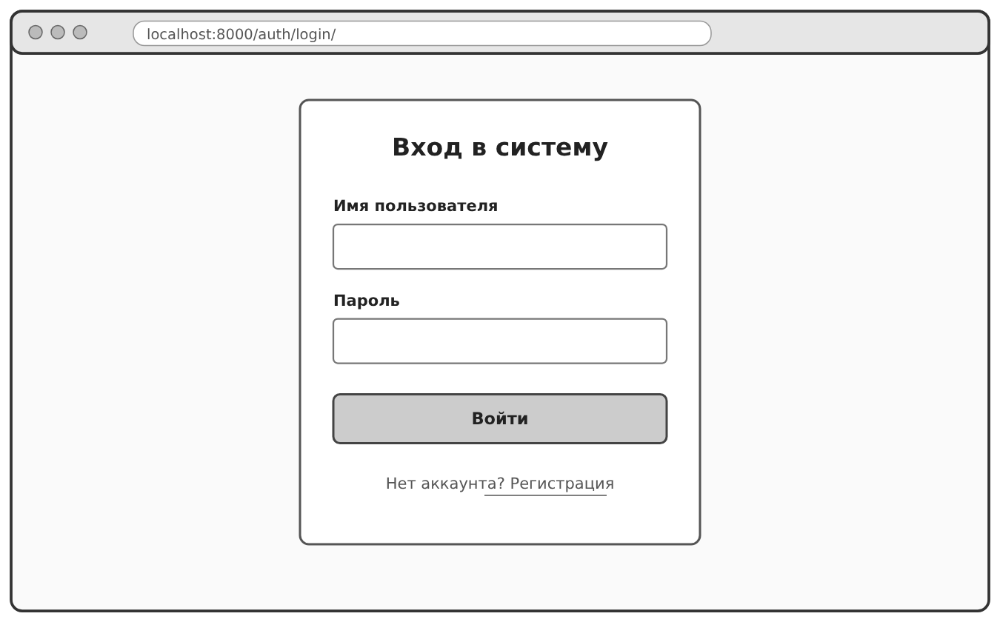
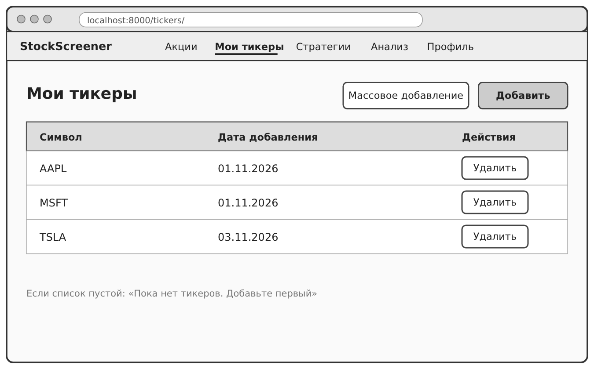
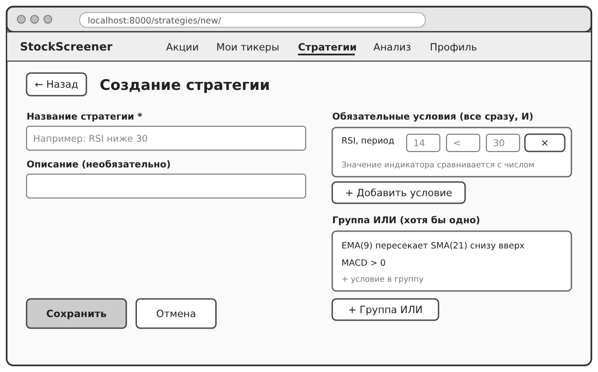
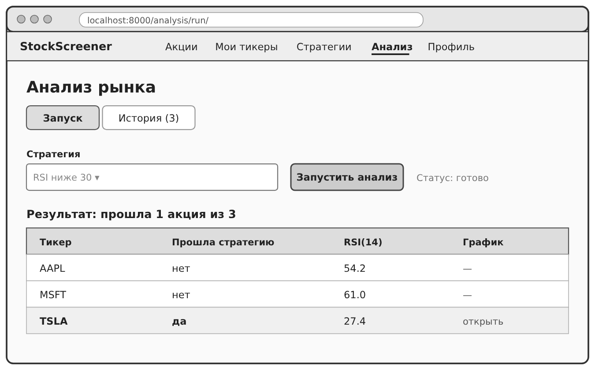

# ДЗ 4. DDD, BDD и Wireframes

Продукт: скринер акций, где стратегию собирают из готовых блоков без программирования.

## 1. Доменные зоны (DDD)

Я разбил приложение на 5 зон. Каждая отвечает за что-то одно и использует свои понятия.

| № | Зона | За что отвечает |
|---|---|---|
| 1 | Пользователи | Регистрация, вход, профиль |
| 2 | Список акций | Тикеры, которые пользователь хочет проверять |
| 3 | Стратегии | Конструктор, условия и индикаторы |
| 4 | Анализ | Запуск стратегии по списку акций, результаты, история |
| 5 | Рыночные данные | Цены акций, информация о компании, кэш |

### Глоссарии

**Зона 1. Пользователи**

| Термин | Что значит |
|---|---|
| Пользователь | Человек с аккаунтом (логин и пароль) |
| Профиль | Дополнительные данные пользователя: возраст и баланс |
| Вход | Проверка логина и пароля, после неё человек видит только свои данные |

**Зона 2. Список акций**

| Термин | Что значит |
|---|---|
| Тикер | Короткий код акции на бирже, например AAPL для Apple |
| Список акций | Все тикеры, которые пользователь добавил себе |
| Массовое добавление | Добавление сразу нескольких тикеров одним списком |

**Зона 3. Стратегии**

| Термин | Что значит |
|---|---|
| Стратегия | Набор условий, по которым ищутся подходящие акции |
| Индикатор | Число, которое считается по графику акции, например RSI или SMA |
| Условие | Одно правило: индикатор, знак сравнения и число, например RSI < 30 |
| Обязательное условие | Условие, которое должно выполниться всегда (логика И) |
| Группа ИЛИ | Несколько условий, из которых достаточно, чтобы выполнилось любое одно |

**Зона 4. Анализ**

| Термин | Что значит |
|---|---|
| Запуск | Одна проверка стратегии по всему списку акций |
| Задача | Расчёт, который идёт в фоне, у неё есть свой номер (task_id) |
| Статус | В каком состоянии запуск: ещё считается или уже готов |
| Результат | Какие акции прошли стратегию и почему |
| История | Список прошлых запусков |

**Зона 5. Рыночные данные**

| Термин | Что значит |
|---|---|
| Свеча | Данные о цене акции за один период: открытие, максимум, минимум, закрытие и объём |
| Таймфрейм | Длина одной свечи: 5 минут, час, день и так далее |
| Кэш | Временное хранилище, чтобы не скачивать одни и те же данные много раз |
| Источник данных | Yahoo Finance |

### Как зоны связаны

```
Пользователи
   ├── Список акций ──┐
   └── Стратегии ─────┼──► Анализ ◄── Рыночные данные
```

Всё принадлежит конкретному пользователю. Анализ берёт тикеры из списка акций и условия из стратегии, а цены для расчёта получает из рыночных данных.

## 2. BDD: главный путь MVP

Главный путь: пользователь запускает анализ по своему списку акций и смотрит результат. Без него продукт теряет смысл.

```
Функционал: Запуск анализа по списку акций

  Сценарий: Пользователь запускает анализ и видит результат
    Дано я вошёл в аккаунт
      И в моём списке акций есть AAPL, MSFT и TSLA
      И у меня есть стратегия «RSI ниже 30»
    Когда я открываю страницу «Анализ»
      И выбираю стратегию «RSI ниже 30»
      И нажимаю «Запустить анализ»
    Тогда я вижу, что расчёт идёт
      И когда расчёт закончится, я вижу, какие акции прошли стратегию
      И этот запуск появляется в истории

  Сценарий: В списке нет ни одной акции
    Дано я вошёл в аккаунт
      И мой список акций пустой
    Когда я выбираю стратегию и нажимаю «Запустить анализ»
    Тогда я вижу сообщение «У вас нет тикеров для анализа»
      И запуск не создаётся
```

## 3. Wireframes

Нарисовал 4 экрана, через которые проходит главный путь. Это схемы без цветов и дизайна, важно только расположение элементов.

### Экран 1. Вход



Два поля (имя пользователя и пароль), кнопка «Войти» и ссылка на регистрацию для тех, у кого ещё нет аккаунта.

### Экран 2. Мои тикеры



Таблица с акциями пользователя. Сверху кнопки «Добавить» для одной акции и «Массовое добавление» для списка. У каждой акции есть кнопка «Удалить».

### Экран 3. Создание стратегии



Название и описание стратегии. Справа условия: обязательные (должны выполниться все) и группа ИЛИ (достаточно одного). Условия можно добавлять и удалять.

### Экран 4. Анализ



Выбор стратегии и кнопка запуска. После расчёта внизу появляется таблица: какие акции прошли и какое получилось значение индикатора. У прошедших акций есть ссылка на график.

## 4. JSON-контракты

Для главного пути нужны две ручки: запуск анализа и проверка статуса. После запуска страница каждые несколько секунд спрашивает статус, пока расчёт не закончится.

### 4.1. Запуск анализа

`POST /analysis/api/run/`

Запрос:

```json
{
  "strategy_id": 12
}
```

Тикеры в запросе не передаём, сервер сам берёт их из списка акций пользователя.

Ответ, код 200:

```json
{
  "success": true,
  "task_id": "9f1c2b7e-4d3a-4a77-8e21-5b0c3a1d6f10",
  "strategy_id": 12
}
```

Ответ, если в списке нет акций, код 400:

```json
{
  "success": false,
  "error": "У вас нет тикеров для анализа"
}
```

| Поле | Тип | Что значит |
|---|---|---|
| strategy_id | число | Номер стратегии, которую запускаем |
| success | true / false | Получилось ли поставить расчёт в очередь |
| task_id | строка | Номер задачи, по нему потом спрашиваем статус |
| error | строка | Что пошло не так (только при ошибке) |

### 4.2. Статус и результат

`POST /analysis/api/status/`

Запрос:

```json
{
  "task_id": "9f1c2b7e-4d3a-4a77-8e21-5b0c3a1d6f10",
  "strategy_id": 12
}
```

Ответ, пока расчёт идёт, код 200:

```json
{
  "success": true,
  "status": "pending"
}
```

Ответ, когда расчёт закончился, код 200:

```json
{
  "success": true,
  "status": "completed",
  "run_id": 45,
  "strategy_name": "RSI ниже 30",
  "tickers_analyzed": 2,
  "tickers_matched": 1,
  "matched": ["TSLA"],
  "details": [
    {
      "ticker": "TSLA",
      "matched": true,
      "conditions": [
        {
          "label": "RSI",
          "indicator": "rsi",
          "params": { "length": 14 },
          "operator": "<",
          "threshold": 30,
          "value": 27.4,
          "passed": true,
          "group_type": "must",
          "group_id": null,
          "error": null
        }
      ],
      "error": null
    },
    {
      "ticker": "AAPL",
      "matched": false,
      "conditions": [
        {
          "label": "RSI",
          "indicator": "rsi",
          "params": { "length": 14 },
          "operator": "<",
          "threshold": 30,
          "value": 54.2,
          "passed": false,
          "group_type": "must",
          "group_id": null,
          "error": null
        }
      ],
      "error": null
    }
  ]
}
```

| Поле | Тип | Что значит |
|---|---|---|
| status | строка | `pending` (считается) или `completed` (готово) |
| run_id | число | Номер запуска в истории |
| tickers_analyzed | число | Сколько акций проверили |
| tickers_matched | число | Сколько акций прошли стратегию |
| matched | список строк | Тикеры, которые прошли стратегию |
| details | список | Подробности по каждой акции |
| conditions[].value | число | Значение индикатора сейчас |
| conditions[].threshold | число | Число из условия, с которым сравнивали |
| conditions[].passed | true / false | Выполнилось ли это условие |
| conditions[].group_type | строка | `must` (обязательное) или `or` (из группы ИЛИ) |

Если сервис расчёта не отвечает, возвращается код 502 и `{ "success": false, "error": "..." }` с текстом ошибки.
