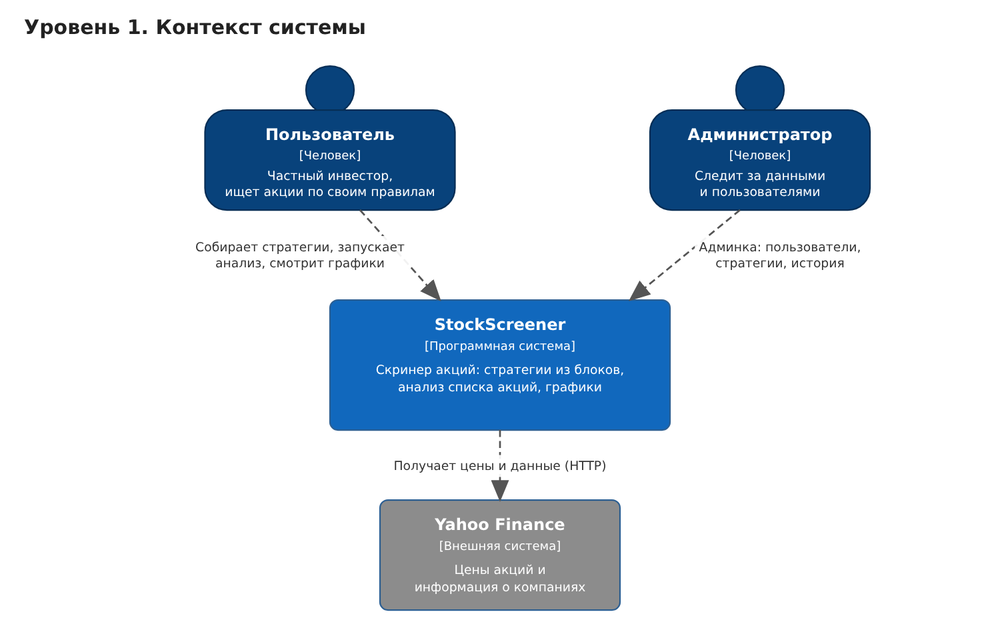
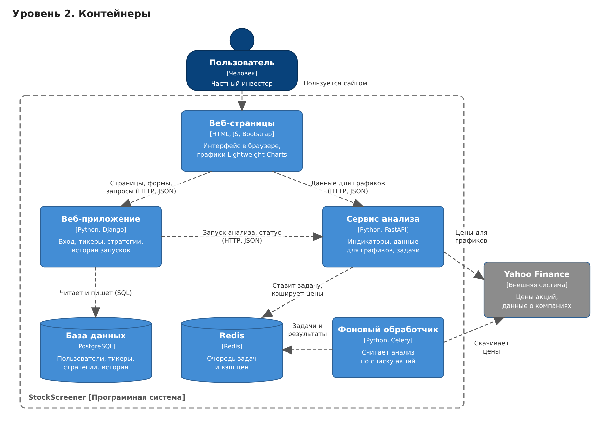

# ДЗ 5. Схема C4

Продукт: скринер акций, где стратегию собирают из готовых блоков без программирования.

Ниже две схемы по модели C4: первый уровень (контекст) и второй уровень (контейнеры).

## Уровень 1. Контекст

На этом уровне видно, кто пользуется системой и с какими внешними сервисами она связана.

- **Пользователь** - частный инвестор. Добавляет акции, собирает стратегии, запускает анализ и смотрит графики.
- **Администратор** - через админку следит за пользователями, стратегиями и историей запусков.
- **Yahoo Finance** - внешний сервис, откуда мы берём цены акций и информацию о компаниях. Своих рыночных данных у нас нет.

## Уровень 2. Контейнеры

Система состоит из 6 частей:

| Контейнер | Технология | Что делает |
|---|---|---|
| Веб-страницы | HTML, JS, Bootstrap, Lightweight Charts | То, что пользователь видит в браузере: формы, конструктор стратегий, графики |
| Веб-приложение | Python, Django | Вход и регистрация, список акций, стратегии, история запусков, админка |
| Сервис анализа | Python, FastAPI | Считает индикаторы, отдаёт данные для графиков, ставит задачи на анализ |
| Фоновый обработчик | Python, Celery | Выполняет анализ в фоне, чтобы сайт не зависал |
| База данных | PostgreSQL | Хранит пользователей, акции, стратегии и историю |
| Redis | Redis | Очередь задач для обработчика и кэш цен, чтобы не скачивать одно и то же много раз |

Как проходит анализ по шагам:

1. Пользователь выбирает стратегию на странице и нажимает «Запустить анализ».
2. Веб-приложение берёт из базы его акции и условия стратегии и отправляет их в сервис анализа.
3. Сервис анализа кладёт задачу в очередь в Redis и сразу отвечает номером задачи.
4. Фоновый обработчик берёт задачу, скачивает цены с Yahoo Finance, считает индикаторы и сохраняет результат.
5. Страница раз в несколько секунд спрашивает, готово ли. Когда готово, веб-приложение сохраняет результат в историю и показывает его.

## Почему такие технологии для MVP

| Технология | Почему выбрали |
|---|---|
| Python | Вся команда его знает, и для работы с данными есть готовые библиотеки (pandas, yfinance) |
| Django | Вход, регистрация, работа с базой и админка есть сразу, не надо писать с нуля. Для MVP это экономит много времени |
| FastAPI | Быстрый и простой фреймворк для API. Расчёты вынесены отдельно, чтобы тяжёлые вычисления не тормозили основной сайт |
| Celery + Redis | Анализ сотни акций идёт долго. Через очередь он считается в фоне, и пользователь не ждёт с зависшей страницей |
| Redis как кэш | Если несколько человек смотрят одну и ту же акцию, цены скачиваются один раз |
| PostgreSQL | Бесплатная и надёжная база, хорошо работает с Django, умеет хранить JSON (нужно для условий и результатов) |
| Yahoo Finance | Бесплатные данные по акциям США, для MVP этого хватает |
| Bootstrap, Lightweight Charts | Быстро сделать нормальный интерфейс без дизайнера и бесплатно рисовать свечные графики |
| Docker Compose | Все 6 частей запускаются одной командой, у всех в команде одинаковое окружение |

Что мы понимаем про минусы:

- Yahoo Finance бесплатный, но может менять ограничения или работать нестабильно. Если продукт пойдёт дальше, перейдём на платный источник данных.
- Два сервиса вместо одного сложнее запускать и отлаживать. Поэтому сразу используем Docker Compose.
